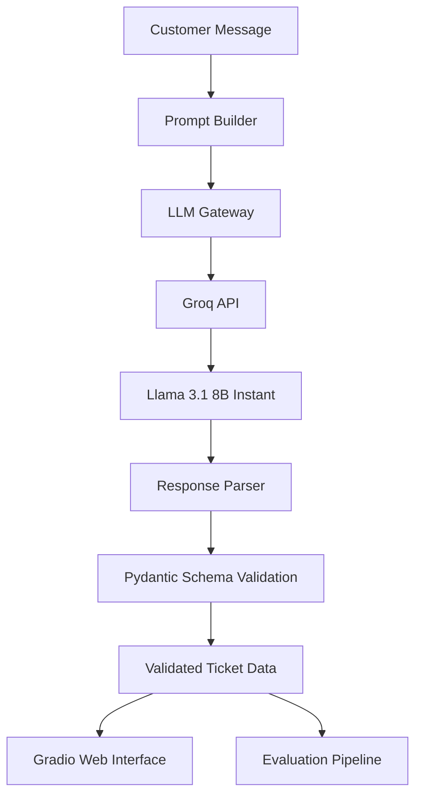

<div align="center">

# 🎫 AutoTicket AI
### Intelligent Customer Support Triage & Structured Information Extraction

Turn unstructured customer messages into structured, actionable support tickets.  
Built with **Python**, **Groq**, **Llama 3.1**, **Pydantic v2**, and **Gradio**.

<p align="center">
  <a href="https://huggingface.co/spaces/Ahmed1022/ticket-classifier">
    
  </a>
  <a href="https://github.com/ahmedyasser1588/AI_Ticket_Classifier">
    
  </a>
  
  
  
  
</p>

</div>

---

## 📌 Overview

Customer support teams receive large volumes of unstructured messages that must be interpreted, categorized, prioritized, and routed to the appropriate team. Manual triage can be time-consuming and inconsistent.

**AutoTicket AI** is an LLM-powered support ticket classification application that transforms raw customer messages into structured ticket data using a defined classification schema.

The project combines LLM inference with software engineering practices, including input-to-output processing, schema validation, parsing and error handling, and quantitative evaluation.

---

## ✨ Key Capabilities

- **Ticket Classification:** Assigns a support category based on the customer's message.
- **Sentiment Analysis:** Identifies customer sentiment (*positive*, *negative*, *neutral*).
- **Urgency Detection:** Estimates the urgency of the reported issue (*low*, *medium*, *high*).
- **Executive Summary:** Generates a concise 1-sentence summary for human support agents.
- **Structured Output Validation:** Uses Pydantic models to validate generated data and eliminate schema violations.
- **Resilient API Integration:** Implements centralized LLM communication and retry handling with exponential backoff.
- **Evaluation Framework:** Supports batch evaluation against labeled support ticket benchmarks.

---

## 🚀 Live Demo

Try the deployed application:  
👉 **[Launch AutoTicket AI on Hugging Face Spaces](https://huggingface.co/spaces/Ahmed1022/ticket-classifier)**

Enter a customer message and inspect the resulting classification and structured output.

### Example

**Input:**
> *"I was charged twice for the same transaction and I need an immediate refund!"*

**Structured Output:**
```json
{
  "category": "billing",
  "sentiment": "negative",
  "urgency": "high",
  "summary": "Customer was double-charged and requests an immediate refund."
}
```
*Note: Example output illustrating the expected schema; actual predictions depend on the model response and application configuration.*

---

## 🏗️ System Architecture

The application separates prompt construction, LLM communication, output parsing, validation, and evaluation into distinct components.



### Processing Pipeline

1. **Prompt Construction:** Builds classification instructions using a predefined category taxonomy and few-shot examples.
2. **LLM Inference:** Sends the request through a centralized gateway to the configured Groq API model.
3. **Response Parsing:** Extracts the structured response and handles supported formatting variations (markdown code fences, extraneous text).
4. **Schema Validation:** Validates the extracted fields against the ticket schema.
5. **Application Output:** Returns the processed ticket to the Gradio interface.
6. **Evaluation:** Compares predictions with labeled data to measure classification performance.

---

## 🛠️ Engineering Highlights

### 1. Structured Data Validation
The application uses Pydantic v2 to define and validate the expected ticket structure. This helps detect malformed responses, unexpected values, and schema violations before the data is consumed by downstream application components.

### 2. Resilient LLM Gateway
LLM communication is encapsulated in a dedicated gateway rather than being scattered across the application. The design supports centralized request handling, retry policies with jittered backoff, and domain-specific exception handling.

### 3. Robust Response Parsing
LLM responses may contain formatting inconsistencies or additional Markdown. The parser provides a dedicated processing layer to extract JSON from supported response formats and validate it against the expected schema. Parsing and validation are separate responsibilities, making the logic easier to test and maintain.

### 4. Modular Architecture
The codebase separates the application into focused components for prompting, schema definition, inference, parsing, configuration, and evaluation. This separation of concerns makes individual components easier to understand, test, debug, and extend.

### 5. Quantitative Evaluation
The evaluation framework supports batch testing on a labeled dataset. It is designed to measure:

| Metric | Purpose |
|---|---|
| **Validity Rate** | Percentage of outputs that satisfy the expected schema |
| **Category Accuracy** | Correctness of predicted ticket categories |
| **Sentiment Accuracy** | Correctness of predicted sentiment labels |
| **Urgency Accuracy** | Correctness of predicted urgency labels |
| **Overall Success Rate** | Successful processing according to the evaluator's defined criteria |
| **Failure Count** | Number of failed or unsuccessful evaluation cases |

---

## 💻 Technology Stack

| Component | Technology |
|---|---|
| **Programming Language** | Python 3.10+ |
| **LLM Inference** | Groq API |
| **Language Model** | Llama 3.1 8B Instant |
| **Data Validation** | Pydantic v2 |
| **API Integration** | OpenAI-compatible Python SDK |
| **Web Interface** | Gradio |
| **Configuration** | `pydantic-settings`, `python-dotenv` |
| **Evaluation** | Pandas and custom evaluation modules |
| **Deployment** | Hugging Face Spaces |

---

## 📂 Project Structure

```plaintext
AI_Ticket_Classifier/
│
├── app.py                     # Gradio Web Interface
├── prompts/
│   └── classifier_prompt.py   # Few-shot prompt builder
├── structured/
│   ├── schema.py              # Pydantic TicketSchema definition
│   ├── parser.py              # Robust parser with regex fallback
│   ├── generator.py           # Outlines model generation adapter
│   └── outline_adapter.py     # Transformers adapter
├── LLM/
│   ├── base.py                # Abstract LLM Interface
│   ├── openai.py              # OpenAI-compatible API client
│   ├── gateway.py             # Resilient gateway with retry logic
│   ├── config.py              # Pydantic Settings configuration
│   ├── exceptions.py          # Custom domain exceptions
│   ├── Model.py               # GenerationRequest & Message dataclasses
│   └── ticket_classifier.py   # Triage domain service
├── evaluation/
│   ├── evaluator.py           # Batch evaluation pipeline
│   ├── metrics.py             # Accuracy & validity metric functions
│   └── models.py              # EvaluationModel dataclass
├── Data/
│   └── tickets.csv            # Evaluation dataset
├── requirements_deployment.txt # Minimal deployment dependencies
├── .env.example               # Environment variables template
├── .gitignore                 # Protected secrets and files
└── README.md
```

---

## 🚦 Getting Started

### Prerequisites
- Python 3.10 or newer
- A [Groq API key](https://console.groq.com/)
- Git

### 1. Clone the repository
```bash
git clone https://github.com/ahmedyasser1588/AI_Ticket_Classifier.git
cd AI_Ticket_Classifier
```

### 2. Create a virtual environment

**Windows (PowerShell):**
```powershell
python -m venv .venv
.\.venv\Scripts\Activate.ps1
```

**Linux / macOS:**
```bash
python -m venv .venv
source .venv/bin/activate
```

### 3. Install dependencies
```bash
pip install -r requirements_deployment.txt
```

### 4. Configure environment variables
Create a `.env` file using `.env.example` as a reference:

```ini
LLM_api_key=your_groq_api_key
LLM_base_url=https://api.groq.com/openai/v1
LLM_Model=llama-3.1-8b-instant
```

> **Security Note:** Never commit your `.env` file or API keys to GitHub. Use your deployment platform's secret-management settings for hosted applications.

### 5. Run the application
```bash
python app.py
```
Open the local URL printed by Gradio: **`http://127.0.0.1:7860`**

---

## 📊 Running the Evaluation

The project includes an evaluation pipeline for testing predictions against labeled support tickets:

```python
import pandas as pd
from evaluation.evaluator import TicketEvaluator
from evaluation.metrics import metric_evaluation

df = pd.read_csv("Data/tickets.csv")

# Initialize evaluator with your configured generator
evaluator = TicketEvaluator(generator)
results = evaluator.evaluate(df)
metrics = metric_evaluation(results)

print(metrics)
```

---

## 📐 Design Principles

- **Separation of Concerns:** Distinct modules for inference, parsing, validation, and evaluation.
- **Abstraction:** Dedicated abstract interface for LLM interactions.
- **Fault Handling:** Centralized exception handling and retry policies with jittered backoff.
- **Configuration Management:** Externalized settings via environment variables.
- **Type Safety:** Explicit Pydantic schema definitions and Literal types.
- **Measurability:** Repeatable evaluation pipeline for benchmarking performance.

---

## 🔮 Limitations and Future Improvements

- Expand the labeled dataset and evaluate performance across more ticket domains.
- Add automated unit and integration tests for parsing, validation, and gateway behavior.
- Report reproducible macro-F1, latency, and failure-rate benchmarks.
- Add structured logging and telemetry for inference failures.
- Introduce confidence estimation and human-in-the-loop routing for ambiguous tickets.
- Implement multi-provider fallbacks (e.g., Anthropic / OpenAI fallback).

---

## 📜 License

This project is licensed under the MIT License - see the [LICENSE](LICENSE) file for details.

---

## 👨‍💻 Author

**Ahmed Yasser**  
AI Engineer | Machine Learning | LLM Applications  
- **GitHub:** [@ahmedyasser1588](https://github.com/ahmedyasser1588)  
- **LinkedIn:** [Ahmed Yasser](https://www.linkedin.com/in/ahmedyasserengineer/)  

*Interested in AI engineering, LLM-powered applications, and building reliable software systems.*
