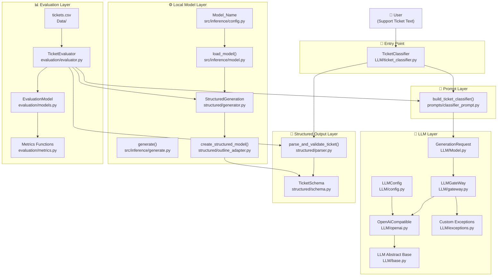
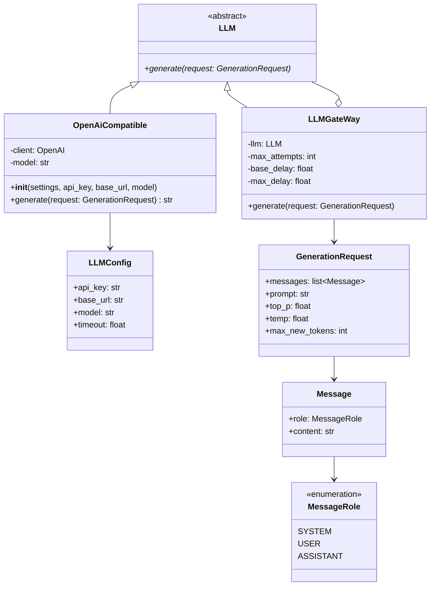
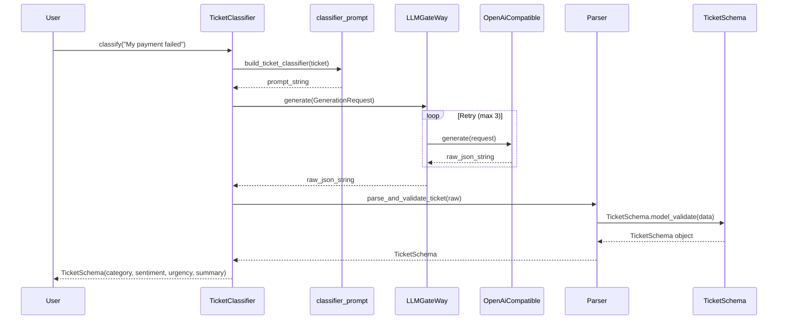
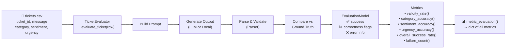

# 🏗️ Architecture + Study Guide + Deployment

## مشروع: AI Ticket Classifier (ME)

---

## 1️⃣ رسم الـ Architecture

### نظرة عامة — تدفق البيانات



---

### رسم تفصيلي — طبقة LLM



---

### رسم تفصيلي — تدفق التصنيف (Request Flow)



---

### رسم تفصيلي — دورة الـ Evaluation



---

## 2️⃣ كيف تذاكر المشروع دا؟

> [!NOTE]
> المشروع بيغطي **3 concepts أساسية**: LLM Abstraction, Structured Output, و Evaluation. اذاكرهم بالترتيب دا.

### 🗺️ خريطة الدراسة (الترتيب المثالي)

#### المرحلة 1 — الأساسيات (يوم 1)

**ابدأ بالـ Schema والـ Data Models:**
1. [`structured/schema.py`](file:///d:/Learning/Cources/Depi_Agentic/Ticket_Classifier_Depi-main/New%20folder/ME/structured/schema.py) — افهم ليه بنستخدم `Pydantic` + `Literal`
2. [`LLM/Model.py`](file:///d:/Learning/Cources/Depi_Agentic/Ticket_Classifier_Depi-main/New%20folder/ME/LLM/Model.py) — افهم `dataclass`, `Enum`, و `frozen=True`
3. [`evaluation/models.py`](file:///d:/Learning/Cources/Depi_Agentic/Ticket_Classifier_Depi-main/New%20folder/ME/evaluation/models.py) — شوف كيف بنخزن نتيجة كل ticket

**اسأل نفسك:** ليه `TicketSchema` بيستخدم `Literal` بدل `str`؟

---

#### المرحلة 2 — Prompt Engineering (يوم 2)

1. [`prompts/classifier_prompt.py`](file:///d:/Learning/Cources/Depi_Agentic/Ticket_Classifier_Depi-main/New%20folder/ME/prompts/classifier_prompt.py) — لاحظ:
   - تعريف كل category بمثال
   - وجود few-shot examples
   - format المطلوب من الموديل

**تمرين:** جرب تعدل الـ prompt وشوف إزاي بيأثر على النتيجة.

---

#### المرحلة 3 — LLM Abstraction Layer (يوم 3-4)

بالترتيب:
1. [`LLM/exceptions.py`](file:///d:/Learning/Cources/Depi_Agentic/Ticket_Classifier_Depi-main/New%20folder/ME/LLM/exceptions.py) — Exception Hierarchy
2. [`LLM/base.py`](file:///d:/Learning/Cources/Depi_Agentic/Ticket_Classifier_Depi-main/New%20folder/ME/LLM/base.py) — Abstract Base Class / Interface
3. [`LLM/config.py`](file:///d:/Learning/Cources/Depi_Agentic/Ticket_Classifier_Depi-main/New%20folder/ME/LLM/config.py) — `pydantic-settings` + `.env`
4. [`LLM/openai.py`](file:///d:/Learning/Cources/Depi_Agentic/Ticket_Classifier_Depi-main/New%20folder/ME/LLM/openai.py) — Concrete Implementation
5. [`LLM/gateway.py`](file:///d:/Learning/Cources/Depi_Agentic/Ticket_Classifier_Depi-main/New%20folder/ME/LLM/gateway.py) — **Decorator Pattern** + Retry Logic

**الـ Pattern المهم هنا:** `LLMGateWay` بيـ"لف" أي `LLM` ويضيف retry بدون ما يغير الـ interface — دا اسمه **Decorator Pattern**.

---

#### المرحلة 4 — Structured Generation (يوم 5)

1. [`src/inference/model.py`](file:///d:/Learning/Cources/Depi_Agentic/Ticket_Classifier_Depi-main/New%20folder/ME/src/inference/model.py) — تحميل Local model من HuggingFace
2. [`structured/outline_adapter.py`](file:///d:/Learning/Cources/Depi_Agentic/Ticket_Classifier_Depi-main/New%20folder/ME/structured/outline_adapter.py) — مكتبة `outlines` للـ Structured Generation
3. [`structured/generator.py`](file:///d:/Learning/Cources/Depi_Agentic/Ticket_Classifier_Depi-main/New%20folder/ME/structured/generator.py) — يجمع الاتنين
4. [`structured/parser.py`](file:///d:/Learning/Cources/Depi_Agentic/Ticket_Classifier_Depi-main/New%20folder/ME/structured/parser.py) — JSON parsing + Regex fallback

**الـ Concept المهم:** الفرق بين:
- **Free-form generation** → الموديل يكتب أي حاجة
- **Structured generation (outlines)** → الموديل مقيّد يطلع JSON بالـ schema المحددة فقط

---

#### المرحلة 5 — Evaluation (يوم 6-7)

1. [`evaluation/evaluator.py`](file:///d:/Learning/Cources/Depi_Agentic/Ticket_Classifier_Depi-main/New%20folder/ME/evaluation/evaluator.py) — شوف الـ 4 steps في `evaluate_ticket()`
2. [`evaluation/metrics.py`](file:///d:/Learning/Cources/Depi_Agentic/Ticket_Classifier_Depi-main/New%20folder/ME/evaluation/metrics.py) — افهم الفرق بين:
   - `validity_rate` = هل الموديل طلّع JSON صح؟
   - `category_accuracy` = هل الـ category صح؟
   - `overall_success_rate` = هل كل الحاجات صح؟

**تمرين نهائي:** شغّل الـ evaluator على الـ `tickets.csv` وحلل النتايج.

---

#### 📚 Resources للمذاكرة الجانبية

| الـ Concept | المصدر |
|---|---|
| Pydantic v2 | [docs.pydantic.dev](https://docs.pydantic.dev) |
| Outlines library | [outlines-dev.github.io](https://outlines-dev.github.io/outlines/) |
| OpenAI Python SDK | [platform.openai.com/docs](https://platform.openai.com/docs/libraries) |
| Abstract Base Classes | Python ABC docs |
| Decorator Pattern | Refactoring.Guru |

---

## 3️⃣ Deployment — أفضل خيار مجاني واحترافي

> [!IMPORTANT]
> **🥇 الخيار الأفضل: Hugging Face Spaces + Gradio**
> - مجاني تماماً ✅
> - بورتفوليو احترافي (HuggingFace معروفة في الـ AI community) ✅
> - تدعم Python مباشرة ✅
> - GPU متاح (مجانًا لفترة محدودة) ✅

---

### 🚀 خطة الـ Deployment

#### الخطوة 1 — إنشاء Gradio App

أنشئ ملف `app.py` في root المشروع:

```python
import gradio as gr
from LLM.openai import OpenAiCompatible
from LLM.gateway import LLMGateWay
from LLM.ticket_classifier import TicketClassifier

# Initialize once at startup
llm = OpenAiCompatible(
    api_key="YOUR_GROQ_API_KEY",  # Groq = مجاني + سريع جداً
    base_url="https://api.groq.com/openai/v1",
    model="llama-3.1-8b-instant"
)
gateway = LLMGateWay(llm)
classifier = TicketClassifier(gateway)

def classify_ticket(ticket_text: str):
    try:
        result = classifier.classify(ticket_text)
        return {
            "🏷️ Category": result.category,
            "😊 Sentiment": result.sentiment,
            "🚨 Urgency": result.urgency,
            "📝 Summary": result.summary
        }
    except Exception as e:
        return {"Error": str(e)}

demo = gr.Interface(
    fn=classify_ticket,
    inputs=gr.Textbox(
        label="Support Ticket",
        placeholder="Enter customer support ticket here...",
        lines=4
    ),
    outputs=gr.JSON(label="Classification Result"),
    title="🎫 AI Ticket Classifier",
    description="Classifies support tickets using LLM into category, sentiment, and urgency.",
    examples=[
        ["My payment was charged twice and I need a refund immediately!"],
        ["I can't login to my account, forgot my password."],
        ["Thank you for your amazing support team!"],
    ]
)

demo.launch()
```

---

#### الخطوة 2 — استخدم Groq API (مجاني + سريع)

بدل ما تحتاج OpenAI key مدفوع، استخدم **Groq** — مجاني ومتوافق 100% مع OpenAI SDK:

1. سجّل على [console.groq.com](https://console.groq.com) → مجاني
2. خذ الـ API Key
3. حطه في Hugging Face Secrets

---

#### الخطوة 3 — رفع على Hugging Face Spaces

```bash
# 1. إنشاء حساب على huggingface.co

# 2. إنشاء Space جديد:
#    huggingface.co/new-space
#    اختر: Gradio | Python | Public

# 3. رفع الملفات
git init
git remote add origin https://huggingface.co/spaces/YOUR_USERNAME/ticket-classifier
git add app.py requirements.txt
git commit -m "Initial deployment"
git push
```

**ملف `requirements.txt` للـ deployment:**
```
gradio>=4.0
pydantic>=2.0
pydantic-settings
openai
```

---

#### الخطوة 4 — إضافة الـ Secrets (API Key)

في صفحة الـ Space:
```
Settings → Variables and Secrets → New Secret
Name: GROQ_API_KEY
Value: gsk_xxxxxxxxxx
```

ثم في الكود:
```python
import os
api_key = os.getenv("GROQ_API_KEY")
```

---

### 🏆 مقارنة خيارات الـ Deployment

| المنصة | المجانية | السرعة | الاحترافية | مناسب لـ AI |
|---|---|---|---|---|
| **🥇 HuggingFace Spaces** | ✅ كامل | ⚡ ممتاز | 🏆 عالية جداً | ✅ مصمم لها |
| Streamlit Cloud | ✅ كامل | ✅ جيد | 🥈 متوسطة | ✅ |
| Railway.app | ⚠️ محدود | ✅ جيد | 🥈 متوسطة | ✅ |
| Render.com | ⚠️ ينام | ✅ جيد | 🥈 متوسطة | ✅ |
| Vercel | ❌ Python محدود | ✅ ممتاز | 🏆 عالية | ❌ |

> [!TIP]
> رابط مشروعك على HuggingFace هيبدو كدا:
> `huggingface.co/spaces/YourName/ticket-classifier`
>
> دا رابط professional جداً تحطه في الـ GitHub و LinkedIn والـ CV.

---

### 📁 هيكل الـ Deployment النهائي

```
ME/
├── app.py                  ← Gradio app (جديد)
├── requirements.txt        ← محدّث للـ deployment
├── .env.example            ← template بدون secrets
├── LLM/
│   ├── base.py
│   ├── openai.py
│   ├── gateway.py
│   ├── config.py
│   ├── exceptions.py
│   ├── Model.py
│   └── ticket_classifier.py
├── structured/
│   ├── schema.py
│   └── parser.py
└── prompts/
    └── classifier_prompt.py
```

> [!WARNING]
> **لا ترفع الـ `.env` أبداً على GitHub أو HuggingFace!**
> استخدم الـ Secrets المدمجة في المنصة.
